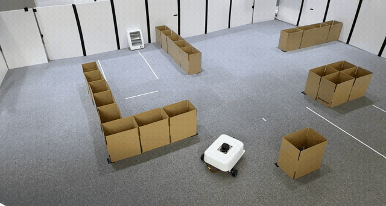
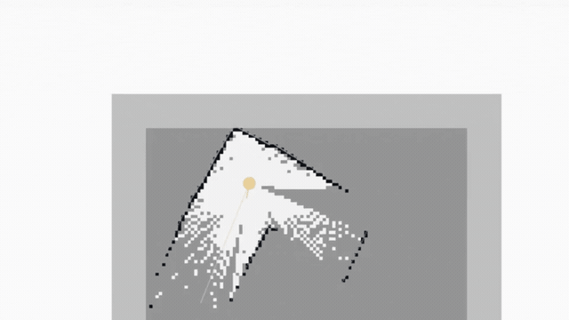
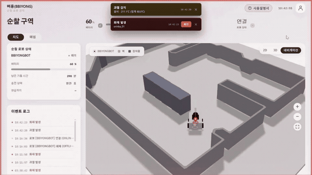
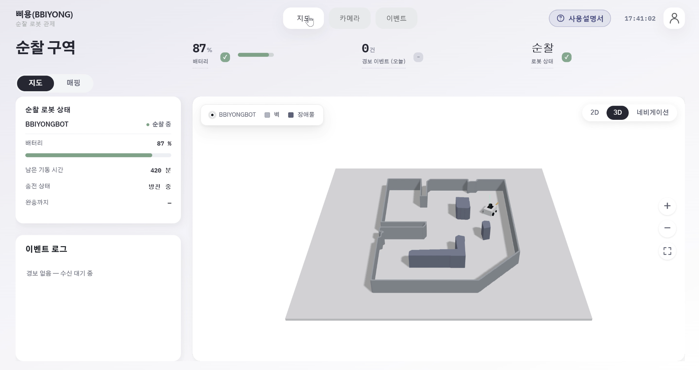
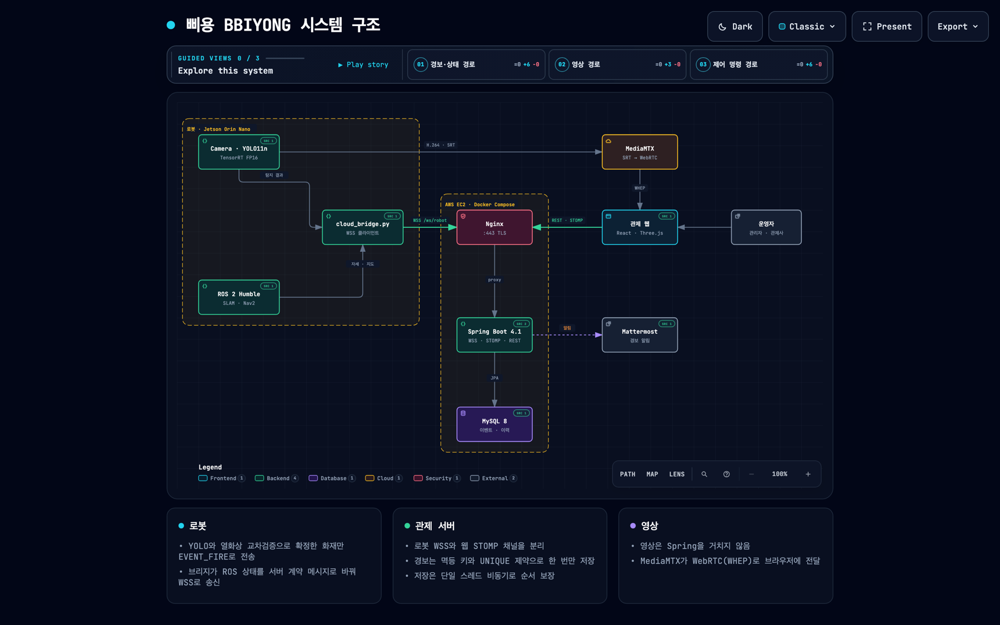

# 삐용 (BBIYONG)

**공장을 순찰하는 로봇의 위치·영상·화재 경보를 웹에서 확인하는 시스템입니다.** 사람이 적은 야간에도 현장을 살펴볼 수 있도록, 로봇이 지도를 만들고 점검 지점을 이동하며 카메라와 열화상 센서로 화재 징후를 확인합니다. 운영자는 관제 웹에서 상황을 보고 로봇을 직접 조종할 수 있습니다.

| 항목 | 내용 |
| --- | --- |
| 기간·인원 | 2026.07.06 ~ 2026.08.10 · SSAFY 15기 6인 팀 |
| 수상 | 공통 프로젝트 우수상 · 부울경 1반 1등 |
| 제 담당 | 팀장, Spring Boot 관제 서버, 로봇·웹 통신, 경보 저장과 인증, 릴리스 통합 |
| 사용 기술 | Java 17, Spring Boot, WebSocket, STOMP, MySQL 8, Docker |

[실제 시연](#실제-시연) · [제가 맡은 일](#제가-맡은-일) · [문제 해결](#문제-해결) · [종료 후 개인 개선](#프로젝트-종료-후-개인-개선) · [실행 방법](#실행-방법)

## 제가 맡은 일

저는 로봇과 관제 웹 사이의 서버를 만들었습니다. 로봇이 보내는 위치·온도·경보를 받아 웹에 전달하고, 웹에서 내린 명령을 로봇으로 보냅니다. 경보 이력과 통계, 지도·순찰 관련 API도 구현했습니다.

로봇과 연결할 때는 전용 WebSocket을, 관제 웹에 상태를 알릴 때는 STOMP를 사용했습니다. 로봇 쪽 연결 코드가 없어 데이터가 들어오지 않던 시점에는 `cloud_bridge.py`를 작성해 로봇에서 웹까지 통신을 연결했습니다. 팀장으로서는 Jira 운영 규칙과 브랜치 전략을 정하고 파트별 코드를 최종 릴리스로 통합했습니다.

로봇 주행과 AI 모델 최적화, 관제 화면과 인프라는 팀원들이 나누어 개발했습니다. 아래 DB 인덱스·Flyway·추가 동시성 검증은 **팀 프로젝트가 끝난 뒤 개인 저장소에서 진행한 작업**입니다.

## 실제 시연

박스로 장애물을 구성한 실내 공간에서 실제 로봇이 이동하는 20초 영상입니다. 원래 속도를 유지했습니다.

<p align="center">
  <a href="docs/assets/readme/autonomous-driving.mp4"></a>
</p>

| 지도 생성 | 웹 관제의 경보 |
| :---: | :---: |
| [](docs/assets/demos/mapping-progress.mp4) | [](docs/assets/demos/fire-alert.mp4) |

로봇이 만든 지도에서 위치를 확인하고, 경보가 발생하면 이벤트 이력과 관련 영상을 조회합니다. 관제 화면의 지도와 이벤트 값은 발표 당시 시연 데이터입니다.



[우선 지점 순찰 영상](docs/assets/demos/priority-patrol.mp4) · [시연 자료 출처](docs/assets/demos/README.md) · [수상 상장](docs/assets/readme/award-certificate.jpg)

## 문제 해결

### 방화벽 때문에 로봇이 서버에 연결되지 않았습니다

처음에는 TCP 9000번 포트로 통신을 구현했지만, 배포 서버는 해당 포트를 막고 있었습니다. Nginx를 거쳐 443번 포트로 연결하는 WSS로 전환했습니다. 메시지 형식은 유지해 다른 파트가 수정할 범위를 줄였습니다.

로봇 전용 연결과 웹 구독 채널을 나눠, 로봇의 상태 수신과 운영자의 화면 알림을 서버에서 연결했습니다. [통신 구조와 명세](docs/architecture_and_api_spec.md)

### 재접속한 로봇이 오프라인으로 보였습니다

새 연결이 등록된 뒤 옛 연결의 종료 처리가 도착하면서 새 세션 정보까지 지워지고 있었습니다. 새 연결을 등록할 때 옛 연결을 정리하고 닫도록 순서를 바꿨습니다.

연결이 조용히 끊기는 경우에는 상태 데이터가 15초 동안 오지 않으면 오프라인으로 판단합니다. 5초마다 확인하므로 화면 반영까지 최대 20초가 걸립니다. [세션 관리 코드](BE_system/src/main/java/com/bbiyong/server/wss/RobotWebSocketSessionManager.java)

### 경보 저장 때문에 다른 데이터 수신도 밀렸습니다

WebSocket 수신 스레드에서 바로 DB에 저장하던 작업을 전용 비동기 작업으로 옮겼습니다. 평소에는 한 스레드에서 경보를 처리하고, 200건의 대기열이 차면 수신 스레드가 직접 처리하도록 했습니다. 경보를 버리지 않는 대신 이때는 수신이 지연될 수 있습니다. 큐가 가득 찼을 때의 전체 처리 순서까지 보장하는 구조는 아닙니다.

같은 경보가 재전송되면 식별자 `messageId`로 이미 저장한 경보인지 확인합니다. 조회와 저장 사이에 요청이 겹치는 경우는 MySQL UNIQUE 제약으로 막습니다.

[경보 저장 코드](BE_system/src/main/java/com/bbiyong/server/event/service/EventLogService.java) · [비동기 설정](BE_system/src/main/java/com/bbiyong/server/common/config/AsyncConfig.java)

### 원격 조종에 영상이 너무 늦게 도착했습니다

처음에는 STOMP로 영상을 중계했지만 버퍼가 차며 연결이 끊겼습니다. 팀과 함께 영상 경로를 분리했고, 중간에 사용한 HLS는 약 6초의 지연 때문에 원격 조종에 맞지 않았습니다. 저는 웹 재생을 WebRTC(WHEP)로 전환하는 작업을 맡았습니다.

최종 지연은 관제 화면 보정값 기준 약 0.3초입니다. 같은 조건에서 영상 전체 구간을 직접 측정한 값과는 구분합니다. [영상·통신 설정](FE/bbiyong-react/src/live/config.ts)

### 영상 프레임 크기와 서버 버퍼가 맞지 않았습니다

약 30~40KB의 JPEG 프레임이 기본 8KB 버퍼를 넘으면서 연결이 끊겼습니다. 버퍼를 늘린 뒤에는 테스트 환경에서 설정 예외가 발생했습니다. 실제 내장 Tomcat이 만들어질 때만 설정을 적용하도록 수정했습니다.

이후 H.264 키프레임에서도 문제가 재발해, 서버 버퍼를 따로 적지 않고 프로토콜의 최대 메시지 크기에서 계산하도록 바꿨습니다. [WebSocket 설정](BE_system/src/main/java/com/bbiyong/server/wss/WebSocketConfig.java)

## 프로젝트 종료 후 개인 개선

팀 프로젝트가 끝난 뒤 ERD와 저장 코드를 다시 점검했습니다. 시간 범위 조회에 인덱스가 없고, 외래키와 스키마 변경 이력도 부족했습니다. 이 작업은 개인 GitHub 저장소에만 반영했으며 팀 배포 서버에는 적용하지 않았습니다.

| 작업 | 확인한 결과 |
| --- | --- |
| 경보 중복 저장 테스트 | 같은 `messageId`로 100건을 32개 스레드에서 저장하면 성공 1건, UNIQUE 위반 99건. 실제 이벤트 수신 경로도 최종 1건 저장 |
| 조회 인덱스 추가 | 합성 데이터 20만 건에서 최근 24시간 통계 쿼리 55.9ms → 4.9ms. 특정 로봇 조회 62.7ms → 1.3ms |
| Flyway·외래키 도입 | 스키마를 V1·V2로 관리하고 외래키 5개 추가. 없는 이벤트에 영상을 연결하던 API는 400으로 거절 |
| 테스트 환경 정리 | MySQL 8과 Flyway 스키마 위에서 서버 테스트 220건을 실행하는 GitHub Actions 구성 |

조회 시간은 MySQL 8.0.46 Docker, Apple M4 Pro에서 쿼리별 6회 중 첫 실행을 제외한 중앙값입니다. 실제 운영 트래픽의 응답 시간을 측정한 결과는 아닙니다. 실행 계획과 재현 SQL은 [개인 개선 기록](docs/post-project/README.md)에 있습니다.

[](https://github.com/jinsung-mo/-BBIYONG-autonomous_driving_factory_patrol_robot/actions/workflows/backend-ci.yml)

## 시스템 구성

<a href="https://jinsung-mo.github.io/-BBIYONG-autonomous_driving_factory_patrol_robot/docs/architecture/system.html"></a>

로봇은 ROS 2·Nav2로 이동하고, YOLO11n과 열화상 센서로 화재 징후를 확인합니다. Spring Boot 서버는 상태·명령·경보를 전달하고 MySQL에 이력을 저장합니다. 영상은 MediaMTX를 거쳐 웹에서 재생합니다. 로컬 개발 환경은 SQLite를 사용합니다.

매핑 진행 상태는 STOMP 알림과 조회 API로 제공합니다. 화면에 다시 접속하면 현재 상태를 조회하지만, 서버 메모리에 보관하므로 서버가 재시작되면 진행 상태는 사라집니다. [매핑 상태 구현](BE_system/src/main/java/com/bbiyong/server/map/service/MappingStatusService.java)

[경보 처리 흐름도](https://jinsung-mo.github.io/-BBIYONG-autonomous_driving_factory_patrol_robot/docs/architecture/fire-alert.html) · [개선 후 ERD](docs/erd/bbiyong-erd-v2.svg) · [AI 처리량 측정과 환경](AI/deployment/fire_smoke/README.md#verified-jetson-result-2026-08-03)

## 팀과 협업

| 이름 | 담당 |
| --- | --- |
| 모진성 | 팀장, 백엔드 |
| 장효준 | Hardware, AI |
| 고지혁 | Hardware, AI |
| 박재현 | CI/CD, Infra |
| 이승현 | Frontend, VP |
| 이예승 | Frontend, IP |

브랜치와 커밋에 Jira 키를 넣고 파트별 개발 브랜치를 거쳐 통합했습니다. 파트 간 메시지 크기가 어긋나거나 통합이 늦어지는 일을 겪으면서, 문서뿐 아니라 코드의 상수와 통합 테스트로 통신 규약을 맞출 필요를 느꼈습니다.

이 저장소는 팀 GitLab의 결과물을 옮긴 사본이라 초기 커밋 이력이 합쳐져 있습니다. [브랜치 전략](docs/git_branch_guide.md) · [Jira 운영 규칙](docs/jira_convention.md)

## 실행 방법

<details>
<summary>로봇 없이 관제 화면 실행</summary>

Node.js가 있으면 가짜 백엔드로 화면을 확인할 수 있습니다. 실제 로봇과 영상은 연결하지 않습니다.

```bash
cd FE/bbiyong-react
npm ci

# 터미널 1
node tools/verify/serve-fake-backend.mjs

# 터미널 2
VITE_REST_BASE_URL=http://localhost:8099 \
VITE_WS_URL=ws://localhost:8099/ws/control \
npm run dev
```

`http://localhost:5173`에서 아무 이메일과 비밀번호로 로그인합니다. 이메일에 `viewer`가 들어가면 일반 사용자 권한으로 접속합니다.

</details>

<details>
<summary>Spring Boot 서버 실행</summary>

Java 17을 사용합니다. `BBIYONG_JWT_SECRET`은 32바이트 이상, `BBIYONG_ROBOT_UPLOAD_TOKEN`은 필수입니다. DB 설정을 생략하면 로컬 SQLite를 사용합니다.

```bash
cd BE_system
./gradlew bootRun
```

MySQL Docker Compose를 사용할 때는 `MYSQL_USER`, `MYSQL_PASSWORD`, `MYSQL_ROOT_PASSWORD`도 설정합니다. [서버 설정](BE_system/src/main/resources/application.properties) · [Compose 설정](BE_system/compose.yaml)

</details>

[백엔드 API 명세](docs/backend_api_specification.md) · [REST API 문서](https://jinsung-mo.github.io/-BBIYONG-autonomous_driving_factory_patrol_robot/docs/api/) · [로봇 실행 안내](BE_robot/README.md) · [AI 실행 안내](AI/README.md) · [설계 결정 기록](docs/adr/README.md)
